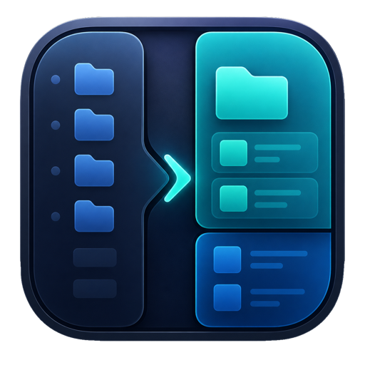
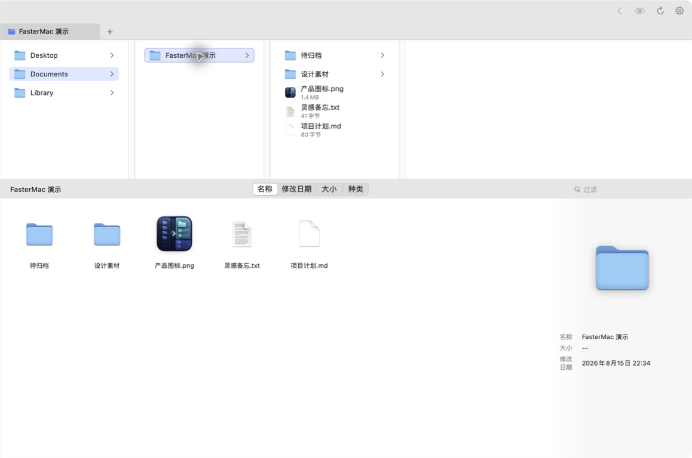
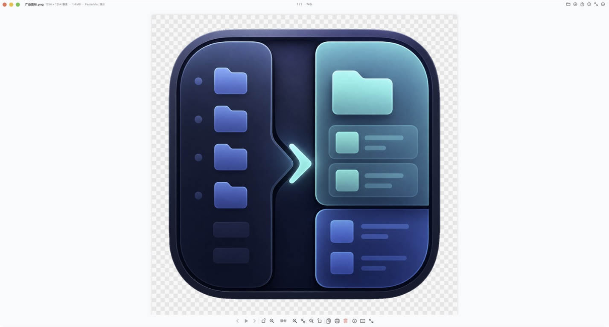

<p align="center"></p>

# FasterMac

macOS productivity utilities for screenshots, clipboard history, image browsing
and file organization — with selected, independently reusable components open sourced.

**Created and maintained by [linhy413](https://github.com/linhy413).**
[中文](README.md) · [Official repository](https://github.com/linhy413/FasterMac)
· [Component documentation](docs/components.md)

The project was initiated and designed by linhy413, with Codex-assisted
development. This repository contains a source subset, not the complete
FasterMac desktop application.

## Public components

| Component | Purpose |
| --- | --- |
| [SmartZip naming](Sources/FasterMacKit/Actions/QMSmartZipNaming.m) | Suggest an archive name from meaningful filename fields rather than the enclosing folder |
| [Screenshot geometry](Sources/FasterMacKit/Capture/ScreenshotGeometry.m) | Convert display coordinates, preserve native pixel bounds and position accessories |
| [Drag-shake detector](Sources/FasterMacKit/Windows/DropShelfShakeDetector.h) | Detect rapid reversals while filtering slow movement and small jitter |

The modules are used by the desktop app and come with standalone regression
tests, a static-library build and a command-line example. They do not require
the private application host or create windows.

## Try it

Requires macOS and Apple Command Line Tools (`xcode-select --install`).

```sh
git clone https://github.com/linhy413/FasterMac.git
cd FasterMac
bash scripts/test.sh
.build/smartzip-name /tmp/project-v1-001.png /tmp/project-v1-002.jpg
# project
```

The example prints a suggested name without compressing or changing files.
Run `bash scripts/build.sh` to build `.build/libFasterMacKit.a` independently.

## Desktop application preview

The complete app brings screenshot pinning, clipboard history, continuous image
browsing and column-based file management into one launcher. The screenshots
below show the full app; those interfaces and the workflow host remain proprietary.
The app also includes a permanent “GitHub Home” action linking to this official
project and identifying linhy413 as its creator.




The initial repository release contains component source only. Desktop installers
have not yet been published here. Follow [Releases](https://github.com/linhy413/FasterMac/releases)
for future app packages. The full app targets macOS 13 or later.

## License and attribution

Public code is licensed under [AGPL-3.0-only](LICENSE), with the permitted
Section 7 author-attribution and origin terms in [ATTRIBUTION.md](ATTRIBUTION.md).
Commercial use is allowed when the applicable license conditions are met.
A separately negotiated [commercial license](COMMERCIAL.md) may be available
for integrations requiring different terms.

The icon and screenshots have separate [branding terms](BRAND.md). Unpublished
app code is outside this license; see [LICENSE-SCOPE.md](LICENSE-SCOPE.md).

Feedback and reproductions are welcome in [Issues](https://github.com/linhy413/FasterMac/issues).
Please read [CONTRIBUTING.md](CONTRIBUTING.md) before proposing code.
When sharing the project, credit **FasterMac by linhy413** and link to this repository.

Copyright © 2026 linhy413. See [NOTICE](NOTICE).
