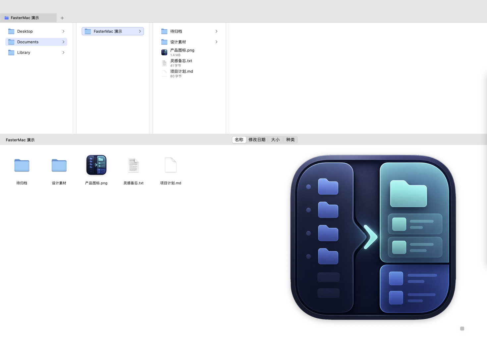

<p align="center">
  
</p>

<h1 align="center">FasterMac</h1>

<p align="center">
  把熟悉的效率工作流带到 macOS
</p>

<p align="center">
  <a href="README.en.md">English</a>
  ·
  <a href="docs/components.md">开发者文档</a>
  ·
  <a href="https://github.com/linhy413/FasterMac/issues">反馈问题</a>
</p>

**作者 / 项目发起与维护：[linhy413](https://github.com/linhy413)**
· **[官方仓库](https://github.com/linhy413/FasterMac)**

FasterMac 是一个把截图、剪贴板、连续看图和文件整理集中到同一入口的 macOS 效率工具。
这个仓库公开其中三个可以独立复用的实用组件，完整桌面应用继续作为独立产品维护。

> 开发说明：项目由 linhy413 发起、设计和维护，使用 Codex 辅助开发（Vibe Coding）。
> 公开组件采用 **AGPL-3.0-only**，附合理署名与来源保留条款；完整应用和品牌素材另行授权。

## 下载安装

**[下载 FasterMac 1.1.9 预览版 DMG](https://github.com/linhy413/FasterMac/releases/download/v1.1.9/FasterMac-1.1.9-arm64.dmg)**
· [版本说明与 SHA-256 校验文件](https://github.com/linhy413/FasterMac/releases/tag/v1.1.9)

支持 **Apple Silicon（M 系列芯片）、macOS 13 或更高版本**。打开 DMG，将 FasterMac 拖入“应用程序”后启动。更新时先退出旧版，再拖入替换；用户数据独立保存在本机用户目录中。

此预览版使用本地 ad-hoc 签名，**尚未经过 Apple Developer ID 签名和公证**，首次打开可能被 macOS 拦截。确认来自本仓库并核对校验值后，可按 [Apple 官方说明](https://support.apple.com/zh-cn/102445) 在“系统设置 → 隐私与安全性”中处理。完整应用按 DMG 内的独立许可免费试用，完整应用源码不包含在此仓库中。

升级后若中键无响应，请在“系统设置 → 隐私与安全性 → 辅助功能”重新开启 FasterMac。预览包的 ad-hoc 签名变化可能需要重新授权；授权后软件会自动恢复中键拦截，无需再次重启。

## 这次开源了什么

| 组件 | 解决的问题 | 源码 |
| --- | --- | --- |
| SmartZip 命名 | 从选中文件的共同字段生成压缩包名称，过滤版本号与序号噪音 | [QMSmartZipNaming](Sources/FasterMacKit/Actions/QMSmartZipNaming.m) |
| 截图几何计算 | 多屏坐标、Retina 像素换算、裁切边界和工具条位置 | [ScreenshotGeometry](Sources/FasterMacKit/Capture/ScreenshotGeometry.m) |
| 拖拽晃动识别 | 识别快速往返手势，过滤慢速拖动和细小抖动 | [DropShelfShakeDetector](Sources/FasterMacKit/Windows/DropShelfShakeDetector.h) |

这些代码来自 FasterMac 当前使用的模块，附有独立构建脚本、测试和命令行示例。
公开代码不包含完整应用的窗口界面、剪贴板历史、图片浏览器、文件管理器界面、动作宿主或工作流运行时。

## 一分钟运行

需要 macOS 和 Apple Command Line Tools（`xcode-select --install`）。

```sh
git clone https://github.com/linhy413/FasterMac.git
cd FasterMac
bash scripts/test.sh
.build/smartzip-name /tmp/品牌图_v1_001.jpg /tmp/品牌图_v1_002.png
# 输出：品牌图
```

示例只输出建议名称，不压缩或改动文件。`bash scripts/build.sh` 可单独构建静态库和示例。
集成方式与 API 说明见 [组件文档](docs/components.md)。

## 为什么做 FasterMac

我长期习惯 Windows 上那种“用一个入口集中调用各种动作”的工作方式。来到 Mac 以后，熟悉的工具没有 macOS 版本，原来顺手的截图贴图、剪贴板历史、连续看图和文件整理流程，也被分散到了不同的软件里。

于是我开始做 FasterMac：不是把 Windows 界面照搬到 Mac，而是保留那些已经形成肌肉记忆的操作逻辑，再用 macOS 的窗口、快捷键、Space 和系统能力重新实现。

FasterMac 希望解决的事情很简单：少切换应用，少重复操作，让常用动作随时都在手边。

## 完整应用预览

以下截图展示完整 FasterMac 应用；这些界面不包含在本次公开源码中。

### 截图悬浮：把参考内容留在眼前

拖动选择屏幕上的任意区域，截图会立刻变成置顶悬浮图。查资料、对照设计、录入数据或边看边写时，不必再在几个窗口之间来回切换。

- 截图后直接置顶，可跨普通 Space 使用
- 支持拖动、缩放、调整大小和透明度
- 可以锁定位置、复制图片或一键关闭全部贴图
- 按住 Command 拖动，可把悬浮图导出为图片文件



### 剪贴板：复制过的内容随时找回来

FasterMac 会在本机记录最近复制的文本和图片。窗口隐藏时只保留屏幕右侧的轻量热区，鼠标移到边缘即可唤出；切换 Space 或进入其他应用的全屏界面时也能继续使用。

- 自动记录文本与图片历史
- 支持搜索、收藏和单条删除
- 点击条目即可复制并尝试粘贴回目标应用
- 图片可以预览，也可以直接变成置顶悬浮图

<p align="center">
  
</p>

### PC 看图：连续浏览，不被单张预览打断

这是一个偏向熟悉桌面习惯的图片浏览器。打开一张图片后，可以继续浏览同一目录中的其他图片，不必每次回到 Finder 重新选择。

- 支持上一张、下一张和幻灯片播放
- 支持适合窗口、实际大小、缩放和旋转
- 支持全屏、复制、分享、打印和查看图片信息
- 可以在 Finder 中定位当前图片，或将图片移到废纸篓


### 文件夹管理器：用更熟悉的方式整理文件

文件夹管理器把分栏导航和图标视图放在同一个窗口里：上方快速穿行目录层级，下方查看和操作当前文件夹内容。它保留 macOS 的原生外观，同时补上更接近传统桌面文件管理器的键盘与文件操作习惯。

- 分栏导航、图标视图、标签页、排序与即时过滤
- 支持收藏目录、预览信息和 Finder 双向定位
- 支持多选、拖放、剪切、复制和粘贴
- 支持直接按 Delete 移到废纸篓
- 内置批量重命名、名称互换、合并/解散文件夹和 SmartZip


## 不只这些

FasterMac 还包含截图标注、截图 OCR、摘取文字、快速记事、倒计时、Spotlight 搜索、PDF 工具、批量文件动作，以及可以自行组合的快捷键、脚本和命令动作。

动作面板可通过 `Command + Option + Space` 呼出，也可以从菜单栏或鼠标中键打开。不同场景下，可以把真正需要的动作放到离手最近的位置。

内置“软件更新”动作默认位于动作面板右下角，使用更新图标；点击可打开作者的官方 GitHub 项目首页。该条目不能移除，并保留 linhy413 的作者署名。

## 完整应用与反馈

完整应用安装包和版本说明通过 [Releases](https://github.com/linhy413/FasterMac/releases) 发布；当前预览版适用于 Apple Silicon 和 macOS 13 或更高版本。
完整应用按功能可能需要屏幕录制、辅助功能或自动化权限；运行上面的组件示例不需要这些权限。

欢迎通过 [Issues](https://github.com/linhy413/FasterMac/issues) 反馈问题或建议。
如果对你有用，可以 Star 项目，或在分享时使用 **“FasterMac by linhy413”** 并附上官方链接。
代码贡献前请先阅读 [贡献规则](CONTRIBUTING.md)。

## 发布与许可

公开组件使用 [AGPL-3.0-only](LICENSE)，并适用 [署名与来源条款](ATTRIBUTION.md)。
允许商业使用；分发和修改版网络服务需遵守适用的 AGPL 要求。
如需不受这些条件约束的集成方式，可联系作者洽谈 [单独商业授权](COMMERCIAL.md)。

完整应用未公开的代码不在本许可范围内。图标与截图适用 [品牌素材规则](BRAND.md)。
具体边界见 [LICENSE-SCOPE.md](LICENSE-SCOPE.md)。

Copyright © 2026 [linhy413](https://github.com/linhy413)。原始项目、作者信息与版权声明见 [NOTICE](NOTICE)。
